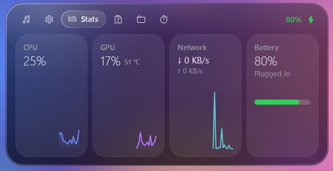

# WinUltra

**A glass Dynamic Island, a desktop clock, and a floating taskbar for Windows 11, in one small app.**

-0A84FF?style=flat-square)


A thin glowing line sits at the top of your screen. Hover it and it grows into an island with your music, quick controls, system stats, clipboard history, a file shelf, and timers. It also puts a clean clock on your desktop and can give your taskbar rounded, floating corners.

<p align="center">
  
</p>

## Highlights

| | |
| --- | --- |
| **The island** | Hover the line or press `Ctrl+Alt+Space`. Rest the mouse on a tab to switch. Move away and it closes. |
| **Live pop-ups** | The island briefly grows to show volume and brightness changes, charger in or out, notifications, earbuds connecting, and Caps Lock. A green or orange dot appears when an app is using your camera or microphone. |
| **Desktop clock** | The weekday in big spaced letters with the date and time underneath. It sits behind your windows and clicks pass straight through. |
| **Clipboard history** | Press the picker hotkey anywhere, click something you copied earlier, and it pastes. |
| **Shelf** | Drop files on the island to park them, drag them out later, or pin files, folders, and apps as one-click launchers. |
| **Floating taskbar** | Rounded and slightly lifted off the screen edge (not in every build, see below). |
| **Private and light** | One `.exe`, no installer, no admin rights, no network access. Settings stay on your PC. |

## Install

1. Double-click `WinUltra.exe`. It installs itself for your account, starts, and will start with Windows from now on. A desktop shortcut is created.
2. Windows may show **"Windows protected your PC"** because the app has no known publisher. Click **More info**, then **Run anyway**.

Requires Windows 11 (64-bit). Uninstall from the tray icon.

## The island

Hover the glowing line at the top of the main screen, or press `Ctrl+Alt+Space`. Rest the mouse on a tab to open it.

| Tab | What it does |
| --- | --- |
| **Media** | Shows what is playing in Spotify, YouTube, or any player. Pause or skip from here. |
| **Controls** | Tap a tile to switch it on or off. Drag the tall sliders for brightness and volume. |
| **Stats** | CPU and graphics load, internet speed, and battery. |
| **Clipboard** | Your recent copies. Click one to paste it. |
| **Shelf** | Files you dropped or pinned. |
| **Timer** | Tap a preset to start. **Focus 25** gives you 25 quiet minutes with no pop-ups. |

<table>
  <tr>
    <td></td>
    <td></td>
  </tr>
  <tr>
    <td></td>
    <td></td>
  </tr>
</table>

## Desktop clock

<p align="center">
  
</p>

To move or resize it:

1. Right-click the clock on the desktop and choose **Edit mode**.
2. Drag it to move it anywhere.
3. Drag the corner handle, or scroll the mouse wheel over it, to resize.
4. Press `Esc` or click away. It remembers the spot.

Right-click it for **Reset size and position** or **Hide clock** (bring it back from the tray icon).

## Keyboard shortcuts

| Shortcut | Action |
| --- | --- |
| `Ctrl+Alt+Space` | Open the island |
| `Win+Shift+V` | Clipboard picker |
| `Ctrl+Alt+Shift+V` | Clipboard picker, used automatically if `Win+Shift+V` is already taken |

The island's Clipboard tab shows which shortcut is active on your PC.

## Tray icon

Find it at the bottom right, maybe under the `^` arrow. From there you can open the island, turn the desktop clock on or off, turn the floating taskbar on or off (in builds that have it), stop starting with Windows, quit, or uninstall.

## Which build do I use?

| File | Built with | Who it is for |
| --- | --- | --- |
| `WinUltra.exe` | `Build.cmd` | Full build: island, clock, floating taskbar. Installs itself and starts with Windows. |
| `WinUltra-NoTaskbar.exe` | `BuildNoTaskbar.cmd` | Same, without the floating-taskbar code, so nothing touches Explorer. |
| "WinUltra for Friends" | `BuildFriends.cmd` | For sharing. A setup window on first run lets each person switch every part on or off. It never copies itself, watches the keyboard, or types keys, and it contains no taskbar code. It runs with normal user rights only. |

The Friends build is written to a `WinUltra for Friends` folder on your desktop and does not replace your own build.

## Privacy

- Nothing is sent anywhere. The source contains no network code.
- Settings, clipboard pins, and the shelf are stored in `%LOCALAPPDATA%\WinUltra` on your PC.
- No administrator rights are requested.

## Build from source

You need only what ships with Windows 11 (the .NET Framework compiler `csc.exe`), plus the Windows SDK metadata file `Windows.winmd` (the build scripts expect SDK `10.0.26100.0`). No Visual Studio or NuGet packages.

```powershell
.\Build.cmd             # WinUltra.exe
.\BuildNoTaskbar.cmd    # WinUltra-NoTaskbar.exe
.\BuildFriends.cmd      # WinUltra for Friends, on your desktop
```

If `WinUltra.ico` is missing, the scripts regenerate it with `MakeIcon.ps1`. To rebuild the quick guide PDF, run `python MakeGuide.py` (needs `reportlab`).

## What is in the repo

```text
src/
  WinUltra.cs   app startup, tray icon, options, install and uninstall
  Island.cs     the island, its tabs, pop-ups, clipboard, shelf, timers
  Clock.cs      the desktop clock
  Friends.cs    first-run setup window for the Friends build
fonts/          Anurati and Montserrat, embedded in the exe
guide-images/   screenshots used by the guide and this README
WinUltra-Guide.pdf   illustrated quick guide for new users
```

## Quick guide

A short illustrated PDF is included: [WinUltra-Guide.pdf](WinUltra-Guide.pdf).
