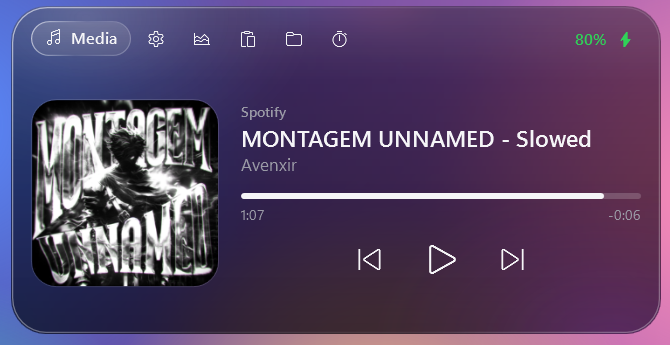
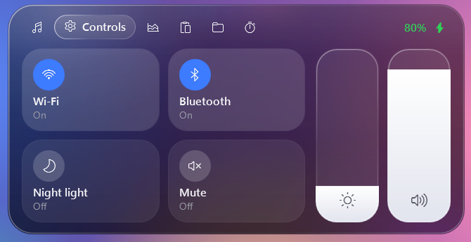

# WinUltra

**A glass Dynamic Island for Windows 11, in one small app.**

-0A84FF?style=flat-square)


[](https://ko-fi.com/gamindusasmitha)

A thin glowing line sits at the top of your screen. Hover it and it grows into an island with your music, quick controls, system stats, clipboard history, a file shelf, and timers.

<p align="center">
  
</p>

## Get started

You need Windows 11 (64-bit). No admin rights are needed.

1. **Download** [WinUltra.exe](https://github.com/Gxmi2006/WinUltra/raw/main/WinUltra.exe). It is a single file of about 300 KB.
2. **Put it in a folder you'll keep**, such as Documents. WinUltra runs from wherever it is and never copies itself anywhere, so its shortcuts point to that spot.
3. **Double-click it.** If Windows shows **"Windows protected your PC"**, click **More info**, then **Run anyway**. This appears because the app is new and not signed by a known publisher, not because anything is wrong (see the [FAQ](#faq)).
4. **Choose what you want** in the setup window: starting when you sign in, a desktop shortcut, clipboard history, notification pop-ups, frosted glass, and a Caps Lock pop-up. Each one is explained, and you can change them any time from the tray icon.
5. **Move your mouse to the glowing line** at the top of your screen, or press `Ctrl+Alt+Space`. That's it.

## Highlights

| Feature | What it does |
| --- | --- |
| **The island** | Hover the line or press `Ctrl+Alt+Space`. Rest the mouse on a tab to switch. Move away and it closes. |
| **Live pop-ups** | The island briefly grows to show volume and brightness changes, charger in or out, notifications, earbuds connecting, and (if you switch it on) Caps Lock. A green dot appears while an app uses your camera, an orange one for the microphone. |
| **Clipboard history** | Press `Win+Shift+V` anywhere, click something you copied earlier, then press `Ctrl+V` to paste it. |
| **Shelf** | Drop files on the island to park them, drag them out later, or pin files, folders, and apps as one-click launchers. |
| **Easy on RAM** | Hands memory back to Windows whenever the island is closed. See [Memory use](#memory-use). |
| **Your choice** | One small `.exe`, no admin rights, no internet access. Every feature that touches your clipboard, notifications, or screen is switched on or off by you. |

## The island

Hover the glowing line at the top of your main screen, or press `Ctrl+Alt+Space`. Rest the mouse on a tab to open it.

| Tab | What it does |
| --- | --- |
| **Media** | Shows what is playing in Spotify, YouTube, or any player. Pause or skip from here. |
| **Controls** | Tap a tile to switch it on or off. Drag the tall sliders for brightness and volume. |
| **Stats** | CPU and graphics load, internet speed, and battery. |
| **Clipboard** | Your recent copies. Click one to copy it again, then press `Ctrl+V`. |
| **Shelf** | Files you dropped or pinned. |
| **Timer** | Tap a preset to start. **Focus 25** gives you 25 quiet minutes with no pop-ups. |

<table>
  <tr>
    <td></td>
    <td></td>
  </tr>
  <tr>
    <td></td>
    <td></td>
  </tr>
</table>

## Keyboard shortcuts

| Shortcut | Action |
| --- | --- |
| `Ctrl+Alt+Space` | Open the island |
| `Win+Shift+V` | Clipboard picker |
| `Ctrl+Alt+Shift+V` | Clipboard picker, used automatically if `Win+Shift+V` is already taken on your PC |

The island's Clipboard tab shows which shortcut is active on your PC.

## Tray icon and removing WinUltra

WinUltra's icon sits at the bottom right of the taskbar, maybe hidden under the `^` arrow. **Click it** to open the island, or **right-click it** to:

- switch **clipboard history**, **notification pop-ups**, **frosted glass**, or the **Caps Lock pop-up** on or off,
- choose whether WinUltra **starts when you sign in**,
- open **Settings...** (the setup window again) or the **data folder**,
- **quit** it, or
- **Remove WinUltra...**: this takes away its shortcuts, settings, clipboard pins, and shelf list, then shows you `WinUltra.exe` so you can delete it.

## FAQ

**Windows or my antivirus warned me about it. Is it safe?**
WinUltra is new and isn't signed with a paid certificate, so Windows SmartScreen doesn't recognise it yet. That is the warning you see. The full source code is in this repo. It never connects to the internet, doesn't need admin rights, never copies itself anywhere, doesn't read your keyboard, and only starts with Windows if you tick that box. If you prefer, you can [build it yourself](#build-from-source).

**I used an older version of WinUltra.**
Older versions installed themselves into `%LOCALAPPDATA%\Programs\WinUltra` and started with Windows automatically. Right-click that version's tray icon and choose **Uninstall** before using this one, so you don't end up with two islands.

**The island disappeared.**
It hides automatically while a full-screen app is in front (games, full-screen videos, presentations), so it never gets in your way. It comes back when you leave full screen. You can always open it with `Ctrl+Alt+Space`.

**Does the camera dot use my camera?**
No. WinUltra never opens your camera or microphone. Windows itself reports when another app starts or stops using them, and WinUltra just shows that as a dot (green for the camera, orange for the microphone) with a short "Camera in use" pop-up.

**The clipboard shortcut doesn't work.**
If another app (or Windows' own clipboard) already uses `Win+Shift+V`, WinUltra switches to `Ctrl+Alt+Shift+V`. The Clipboard tab tells you which one is active. Also check that **Clipboard history** is ticked in the tray menu.

## Privacy

- Nothing is sent anywhere. The source contains no network code.
- You choose each feature in the setup window, and can change your mind from the tray icon.
- Clipboard history skips copies from password managers, and only the items you pin are saved to disk.
- Frosted glass blurs a copy of the bit of screen behind the island. The copy stays in memory and is never saved.
- WinUltra doesn't read your keyboard. The Caps Lock pop-up, when switched on, only checks the Caps Lock light.
- Camera and microphone: WinUltra only reads Windows' own "in use" status. It never opens either device.
- Settings, clipboard pins, and the shelf are stored in `%LOCALAPPDATA%\WinUltra` on your PC.
- No administrator rights are requested.

## Memory use

WinUltra runs quietly in the background, so it gives memory back to Windows whenever it can. A few seconds after you close the island you'll see its memory drop in Task Manager. The first time you open it again after a long break can take a moment longer while that memory is loaded back.

<details>
<summary>Technical details</summary>

| What it does | When |
| --- | --- |
| Collects garbage and trims the island's working set, so Windows can reuse the pages | About 3 seconds after the island closes, and 8 seconds after startup |
| Caps clipboard history at 30 items (pinned items are kept) | As you copy |
| Freezes brushes, pens, and images once built, so WPF can share them instead of copying them | Always |
| Keeps the frosted-glass blur in memory only, never writing it to disk | Always |

The trim is skipped while the island is open, so opening it and switching tabs stays smooth.

</details>

## Build from source

You need only what ships with Windows 11 (the .NET Framework compiler `csc.exe`), plus the Windows SDK metadata file `Windows.winmd` (the build scripts expect SDK `10.0.26100.0`). No Visual Studio or NuGet packages.

```powershell
.\Build.cmd    # builds WinUltra.exe
```

If `WinUltra.ico` is missing, the script regenerates it with `MakeIcon.ps1`. Run `WinUltra.exe --selftest report.txt` to check media, volume, brightness, radios, sensors, notifications, and camera/microphone detection on your PC.

## What is in the repo

```text
src/
  WinUltra.cs   app startup, tray icon, options, removing WinUltra
  Island.cs     the island, its tabs, pop-ups, clipboard, shelf, timers
  Setup.cs      the setup window and the Start-up and desktop shortcuts
guide-images/   screenshots used in this README
WinUltra.manifest   asks Windows for normal user rights only
Build.cmd       builds WinUltra.exe
MakeIcon.ps1    draws WinUltra.ico
LICENSE         MIT License
```

## Support

WinUltra is free. If you enjoy it, you can [support me on Ko-fi](https://ko-fi.com/gamindusasmitha). Starring the repo, reporting bugs, and sharing it with friends helps a lot too.

## Credits

- Promo reel voice-over generated with [ElevenLabs](https://elevenlabs.io) text-to-speech (voice: Liam).
- Promo reel animated with [Remotion](https://www.remotion.dev) and [Three.js](https://threejs.org).

## License

WinUltra is released under the [MIT License](LICENSE).
