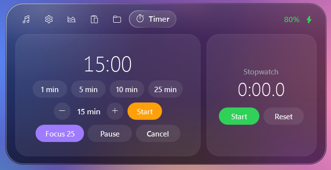

# WinUltra

**A glass Dynamic Island for Windows 11, in one small app.**

-0A84FF?style=flat-square)


A thin glowing line sits at the top of your screen. Hover it and it grows into an island with your music, quick controls, system stats, clipboard history, a file shelf, and timers.

<p align="center">
  
</p>

## Highlights

| | |
| --- | --- |
| **The island** | Hover the line or press `Ctrl+Alt+Space`. Rest the mouse on a tab to switch. Move away and it closes. |
| **Live pop-ups** | The island briefly grows to show volume and brightness changes, charger in or out, notifications, earbuds connecting, and Caps Lock. A green or orange dot appears when an app is using your camera or microphone. |
| **Clipboard history** | Press the picker hotkey anywhere, click something you copied earlier, and it pastes. |
| **Shelf** | Drop files on the island to park them, drag them out later, or pin files, folders, and apps as one-click launchers. |
| **Easy on RAM** | Hands memory back to Windows whenever the island is closed. See [Memory use](#memory-use). |
| **Private** | One `.exe`, no installer, no admin rights, no network access. Settings stay on your PC. |

## Install

1. Double-click `WinUltra.exe`. It installs itself for your account, starts, and will start with Windows from now on. A desktop shortcut is created.
2. Windows may show **"Windows protected your PC"** because the app has no known publisher. Click **More info**, then **Run anyway**.

Requires Windows 11 (64-bit). Uninstall from the tray icon.

## The island

Hover the glowing line at the top of the main screen, or press `Ctrl+Alt+Space`. Rest the mouse on a tab to open it.

| Tab | What it does |
| --- | --- |
| **Media** | Shows what is playing in Spotify, YouTube, or any player. Pause or skip from here. |
| **Controls** | Tap a tile to switch it on or off. Drag the tall sliders for brightness and volume. |
| **Stats** | CPU and graphics load, internet speed, and battery. |
| **Clipboard** | Your recent copies. Click one to paste it. |
| **Shelf** | Files you dropped or pinned. |
| **Timer** | Tap a preset to start. **Focus 25** gives you 25 quiet minutes with no pop-ups. |

<table>
  <tr>
    <td></td>
    <td></td>
  </tr>
  <tr>
    <td></td>
    <td></td>
  </tr>
</table>

## Keyboard shortcuts

| Shortcut | Action |
| --- | --- |
| `Ctrl+Alt+Space` | Open the island |
| `Win+Shift+V` | Clipboard picker |
| `Ctrl+Alt+Shift+V` | Clipboard picker, used automatically if `Win+Shift+V` is already taken |

The island's Clipboard tab shows which shortcut is active on your PC.

## Tray icon

Find it at the bottom right, maybe under the `^` arrow. From there you can open the island, stop starting with Windows, quit, or uninstall.

## Memory use

WinUltra stays running in the background, so it gives memory back whenever it can.

| What it does | When |
| --- | --- |
| Collects garbage and trims the island's working set, so Windows can reuse the pages | About 3 seconds after the island closes, and 8 seconds after startup |
| Caps clipboard history at 30 items (pinned items are kept) | As you copy |
| Freezes brushes, pens, and images once built, so WPF can share them instead of copying them | Always |
| Keeps the frosted-glass blur in memory only, never writing it to disk | Always |

The trim is skipped while the island is open, so opening it and switching tabs stays smooth.

Task Manager will show WinUltra's memory dropping a few seconds after the island closes. Trimming returns idle pages to Windows, and they are loaded back on demand the next time the island opens, so the first open after a long idle can take a moment longer.

## Privacy

- Nothing is sent anywhere. The source contains no network code.
- Settings, clipboard pins, and the shelf are stored in `%LOCALAPPDATA%\WinUltra` on your PC.
- No administrator rights are requested.

## Build from source

You need only what ships with Windows 11 (the .NET Framework compiler `csc.exe`), plus the Windows SDK metadata file `Windows.winmd` (the build scripts expect SDK `10.0.26100.0`). No Visual Studio or NuGet packages.

```powershell
.\Build.cmd    # WinUltra.exe
```

If `WinUltra.ico` is missing, the scripts regenerate it with `MakeIcon.ps1`. To rebuild the quick guide PDF, run `python MakeGuide.py` (needs `reportlab`).

## What is in the repo

```text
src/
  WinUltra.cs   app startup, tray icon, options, install and uninstall
  Island.cs     the island, its tabs, pop-ups, clipboard, shelf, timers
fonts/          Anurati and Montserrat, embedded in the exe
guide-images/   screenshots used by the guide and this README
WinUltra-Guide.pdf   illustrated quick guide for new users
```

## Support

WinUltra is free. If you enjoy it, you can [support me on Ko-fi](https://ko-fi.com/gamindusasmitha).

## Quick guide

A short illustrated PDF is included: [WinUltra-Guide.pdf](WinUltra-Guide.pdf).
